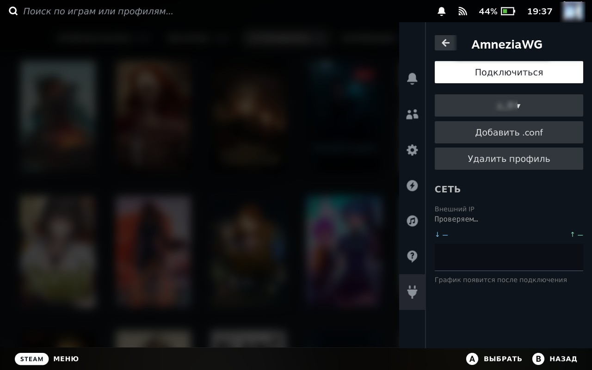
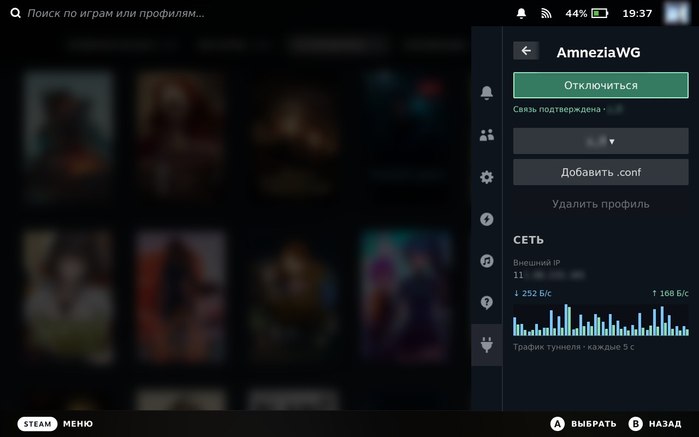

# AmneziaWG для Decky Loader

Плагин для Steam Deck, который подключает **AmneziaWG 3.1** из быстрого меню в Gaming Mode. Импортируйте нативный файл `.conf`, выберите профиль и нажмите **Подключиться**.

## Возможности

- Импорт, выбор и удаление нескольких профилей. Одновременно работает один туннель.
- Подключение и отключение из Decky. Зелёная подсветка показывает, что у текущего туннеля есть свежий handshake с сервером.
- Внешний IP и график скорости приёма и отправки через туннель. Данные обновляются каждые 5 секунд, пока открыта панель.
- Управление с геймпада. **B** закрывает окно подтверждения удаления.

## Скриншоты

| | |
| --- | --- |
| [](1.jpg) | [](2.jpg) |

## Установка

Нужен Steam Deck с установленным Decky Loader. [Установка Decky Loader](https://github.com/SteamDeckHomebrew/decky-loader#-installation)

1. Скачайте [AmneziaWG-Decky.zip](release/AmneziaWG-Decky.zip) на Steam Deck.
2. В Gaming Mode нажмите **⋯ → Decky → ⚙️ → General** и включите **Developer Mode**.
3. Откройте **Developer → Install Plugin from ZIP File**, выберите скачанный ZIP и подтвердите установку.
4. Откройте **AmneziaWG** в меню Decky. При первом открытии плагин автоматически установит сетевые инструменты из архива. Весь процесс проходит в Gaming Mode.

Для обновления отключите VPN и установите новый ZIP поверх текущей версии.

## Импорт профиля

1. В AmneziaVPN при экспорте выберите протокол **AmneziaWG** и **нативный формат AmneziaWG**. На выходе должен получиться файл `.conf` с секциями `[Interface]` и `[Peer]`. [Инструкция Amnezia](https://docs.amnezia.org/documentation/instructions/openwrt-os-awg/)
2. Скопируйте файл в домашнюю папку Steam Deck, например в `/home/deck/Downloads`.
3. В плагине нажмите **Добавить .conf**, откройте папку загрузок и выберите сам файл.
4. Выберите профиль и нажмите **Подключиться**.

Ссылки `vpn://…` предназначены для импорта в AmneziaVPN. Для подключения к серверу AmneziaWG 3.1 используйте его нативный экспорт. Файл содержит приватный ключ. Плагин хранит импортированные профили в `/var/lib/decky-amneziawg/profiles` с доступом только для root и отклоняет конфиги с `PreUp`, `PostUp`, `PreDown`, `PostDown` или `SaveConfig`.

## Как понять, что VPN работает

| Что показывает плагин | Что это означает |
| --- | --- |
| **Отключиться** | На Steam Deck поднят сетевой интерфейс туннеля. |
| Зелёная подсветка и **Связь подтверждена** | За последние три минуты получен handshake. После отзыва ключа предыдущий handshake может ещё отображаться как свежий. |
| **Связь с сервером не подтверждена** или **Нет свежего ответа от сервера** | У интерфейса ещё нет handshake или последнему handshake уже три минуты или больше. |
| **Внешний IP** | Адрес, который видит сервис ipify. При раздельной маршрутизации запрос к нему может идти по обычной сети. [ipify](https://www.ipify.org/) |

Чтобы проверить передачу данных, откройте ресурс, который должен идти через VPN. На графике должны появиться входящий и исходящий трафик. Рост только исходящего счётчика возможен и при недоступном сервере.

## Сборка интерфейса

```sh
npm ci --legacy-peer-deps
npm run build
```

Команды собирают `dist/index.js`. Для установки через Decky ZIP должен содержать одну папку `AmneziaWG/` с `plugin.json`, `package.json`, `main.py`, `dist/index.js` и сетевыми инструментами для Linux x86-64 в `runtime/`.

Готовый архив включает `awg` и `awg-quick` из [amneziawg-tools v3.1.20260812](https://github.com/amnezia-vpn/amneziawg-tools/releases/tag/v3.1.20260812), сборку [amneziawg-go v3.1.20260828](https://github.com/amnezia-vpn/amneziawg-go/tree/v3.1.20260828), контрольные суммы, исходники AmneziaWG Tools и сведения о лицензиях.
